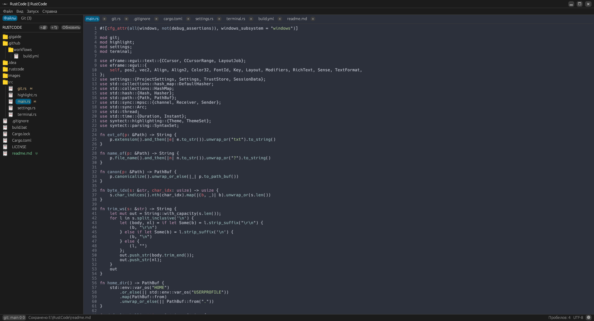

# RustCode

**Прототип, не выкладывать в общий доступ!**

**RustCode** - легковесная IDE, сделана на Rust с egui. Сделана для повседневных и лёгких задач.

С помощью Rust, скорость верстки равна скриптам на C++ и C.
Легкая сборка: встроенный менеджер пакетов и сборок ``cargo`` упращает управление зависимости и проектами.
Безопасность памяти: память контролируется через правила владения, заимствования и времени жизни еще на этапе компиляции. Это защищает от ошибок с памятью и гонок данных без замедления работы программы.

### В чём плюсы RustCode:
1. Git - Add, Commit, Push - всё то, чтобы не потерять проект
2. Workflows - компиляция под две системы сразу: Linux и Windows (можете добавить поддержку MacOS)
3. Поддержка четырёх языков программирования: C++, Python, GO, Rust
4. *Скоро* Поддержка двух языков: Английский и Русский
5. Удобный интерфейс - не нужно привыкать к новому и не надо учиться, чтобы просто начать программировать
6. Терминал - можете сразу запустить вашу команду без запуска PowerShell
7. Удобный запуск: укажите в настройках команду запуска и компиляции и запускайте в редакторе
8. Автосохранение - сохраняйтесь, чтобы не потерять свой прогресс
9. Свободная лицензия - редактируйте, продавайте и делайте всё то, что хотите с этим проектом без бумаг

Для разработчиков своего ПО:
1. Скачайте этот исходник через GitHub: ``git clone https://github.com/K1sh-M1sh-Studio/RustCode .``
2. Изменяйте файлы через ваш IDE
3. Компиляция: ``cmake build --release`` или файл build.bat || Запуск (Для проверки скрипта): ``cmake run``
4. *Обязательно* редактируйте .gitignore, чтобы важные данные и токены не ушли в Git